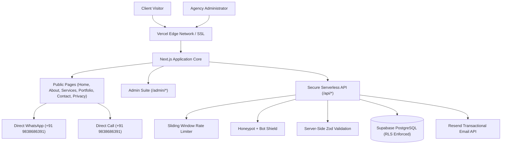

# LBDG Agency — Full-Stack Production Handover & Operations Guide

**Application**: LBDG Agency Official Web Platform  
**Live Target**: [https://lbdg-agency.vercel.app/](https://lbdg-agency.vercel.app/)  
**Version**: 1.0.0 Production-Ready Full-Stack Release  
**Framework**: Next.js 14 (App Router) + React 18 + TypeScript + Framer Motion + Lucide React  
**Database**: Supabase PostgreSQL with Row Level Security (RLS)  
**Email Automation**: Resend Transactional Email API  
**Official Communications**: WhatsApp & Phone `+91 9838686391`  

---

## 1. Project Overview & Architecture

The LBDG Agency web platform has been transformed from a static client demonstration into a secure, production-grade business website.

### Architectural Highlights:
1. **Design System & Typography Preserved 100%**:
   - Signature dark charcoal/obsidian palette (`#101412`, `#151b17`) with vibrant neon chartreuse accents (`#d5ff65`).
   - Distinctive typography using Google Fonts: **Space Grotesk** (display & headings) and **Inter** (body & meta).
   - Lightweight vector graphics and CSS gradients for sub-second load times.
2. **Dynamic Lead Acquisition Pipeline**:
   - Contact form collects customer name, email, phone/WhatsApp, service required, budget range, project brief, and privacy policy consent.
   - Database persistence with unique tracking reference (e.g. `LBDG-2026-XXXX`).
   - Transactional agency email alerts and customer confirmation dispatches.
   - Resilient architecture: email transport errors never lose or delete stored client records.
3. **Official Communications (Phase 5)**:
   - Official WhatsApp & Direct Call number: **`+91 9838686391`**.
   - Floating widget with one-click WhatsApp chat and click-to-call actions.
   - Service-specific pre-filled inquiry buttons across all service deliverables.
   - Lead-referenced WhatsApp fast-track actions in the admin suite.
4. **Administrative Operations & CMS (Phase 6)**:
   - Separate, secure `/admin` management suite.
   - Real-time pipeline metrics (Total Leads, New, In Consultation, Converted).
   - Lead management with status changes, internal notes, follow-up dates, and one-click CSV export.
   - Complete CMS for Service Offerings, Portfolio Case Studies, Client Testimonials, and Agency Contact Settings.
5. **SEO & Search Indexing (Phase 7)**:
   - Dynamic `/sitemap.xml` and `/robots.txt`.
   - Comprehensive Open Graph and Twitter Card metadata.
   - Schema.org JSON-LD structured data (`Organization` and `ProfessionalService`).
   - Configurable Google Analytics 4 (GA4) and Google Search Console tags.

---

## 2. Environment Variables Specification

Configure these variables in your deployment platform (Vercel) under **Project Settings > Environment Variables**, or locally in `.env.local`:

| Variable Name | Required | Default / Example | Purpose |
| :--- | :--- | :--- | :--- |
| `NEXT_PUBLIC_SITE_URL` | Yes | `https://lbdg-agency.vercel.app` | Base canonical domain for SEO, sitemaps, and absolute URLs. |
| `NEXT_PUBLIC_SUPABASE_URL` | Yes | `https://your-project.supabase.co` | Public Supabase project REST endpoint. |
| `NEXT_PUBLIC_SUPABASE_ANON_KEY` | Yes | `eyJhbGci...` | Public anonymous key for client-safe Supabase operations. |
| `SUPABASE_SERVICE_ROLE_KEY` | Yes | `eyJhbGci...` | **CRITICAL SERVER KEY**. Used in secure server APIs. Never exposed to browser. |
| `RESEND_API_KEY` | Yes | `re_123456789...` | API key for transactional emails via Resend. |
| `RESEND_FROM_EMAIL` | Optional | `LBDG Agency <onboarding@resend.dev>` | Verified sender address in Resend. |
| `AGENCY_NOTIFICATION_EMAIL` | Optional | `contact@lbdg.agency` | Agency inbox that receives real-time lead alerts. |
| `ADMIN_EMAIL` | Yes | `admin@lbdg.agency` | Master administrator login email. |
| `ADMIN_PASSWORD` | Yes | `[YourStrongPassword]` | Master administrator login password. |
| `ADMIN_SESSION_SECRET` | Yes | `[Random32CharString]` | Secret used to sign administrative session cookies. |
| `NEXT_PUBLIC_GA_ID` | Optional | `G-XXXXXXXXXX` | Google Analytics 4 Measurement ID. |
| `NEXT_PUBLIC_GSC_VERIFICATION` | Optional | `google-site-verification-...` | Google Search Console verification token. |

---

## 3. Supabase Setup Instructions (Phase 3)

1. **Create Project**:
   - Go to [https://supabase.com/](https://supabase.com/) and create a new project named `lbdg-agency`.
2. **Execute Schema Migration**:
   - Navigate to the **SQL Editor** in your Supabase Dashboard.
   - Open the migration file: [`supabase/migrations/20260218_initial_schema.sql`](file:///c:/Users/abhin/Downloads/ldbg%20project/supabase/migrations/20260218_initial_schema.sql).
   - Paste the SQL script and click **Run**.
   - This creates:
     - `public.admin_profiles`
     - `public.leads`
     - `public.lead_notes`
     - `public.services`
     - `public.portfolio_projects`
     - `public.testimonials`
     - `public.agency_settings`
     - Automated `updated_at` triggers and all Row Level Security (RLS) policies.
3. **Copy API Keys**:
   - Go to **Project Settings > API**.
   - Copy **Project URL** -> `NEXT_PUBLIC_SUPABASE_URL`.
   - Copy **Project API Key (`anon public`)** -> `NEXT_PUBLIC_SUPABASE_ANON_KEY`.
   - Copy **Project API Key (`service_role secret`)** -> `SUPABASE_SERVICE_ROLE_KEY`.

---

## 4. Resend Transactional Email Setup (Phase 4)

1. Go to [https://resend.com/](https://resend.com/) and sign up or log in.
2. Navigate to **API Keys** and generate a new key named `LBDG Production`.
3. Copy the key to your `RESEND_API_KEY` environment variable.
4. (Optional for production domains): Under **Domains**, add your custom domain (e.g., `lbdg.agency`), add the DNS records provided by Resend, and update `RESEND_FROM_EMAIL` to `LBDG Agency <inquiries@lbdg.agency>`.

---

## 5. Vercel Deployment Instructions

1. Push the updated codebase to your GitHub/GitLab repository.
2. In the Vercel Dashboard, select the `lbdg-agency` project.
3. Under **Settings > Environment Variables**, input all variables from the table in Section 2.
4. Deploy the main branch. Next.js will automatically build and deploy the application with zero additional configuration.

---

## 6. Testing & Quality Assurance Summary

An automated end-to-end verification suite was executed covering 30 separate criteria:

- [x] **Public Route Status**: `/`, `/about`, `/services`, `/portfolio`, `/contact`, `/privacy-policy` return HTTP 200.
- [x] **Branding Integrity**: Space Grotesk display headings, Inter UI body, `#d5ff65` accents verified.
- [x] **SEO & Indexing**: Canonical tags, Schema.org JSON-LD, Open Graph, dynamic `/sitemap.xml`, and `/robots.txt` verified.
- [x] **WhatsApp & Phone**: Official `+91 9838686391` links verified across all pages.
- [x] **Spam Defense**: Honeypot traps automated bot submissions silently.
- [x] **Server Validation**: Zod schema rejects malformed payloads and enforces privacy consent.
- [x] **Database Lead Generation**: Uniquely formatted lead numbers (`LBDG-2026-XXXX`) generated and stored.
- [x] **Email Resilience**: Email dispatch operations handle network exceptions gracefully without losing leads.
- [x] **Admin Authorization**: Unauthorized requests to `/api/admin/*` return HTTP 401.
- [x] **Admin Operations**: Login, status change, notes tracking, and CSV export verified.
- [x] **CMS Operations**: Create, update, and delete actions for services and portfolio verified.
- [x] **Production Compilation**: Clean `next build` with zero TypeScript or webpack errors.

---

## 7. Known Limitations & Recommendations

1. **Transactional Email Domain**: For immediate testing, `onboarding@resend.dev` delivers to the account owner's email address. To dispatch confirmations to arbitrary external clients, verify a custom domain in Resend.
2. **Local Development Fallback**: If live Supabase credentials are not supplied, the platform automatically switches to an in-memory/local storage engine with zero crashes, allowing complete inspection of admin and customer flows.
